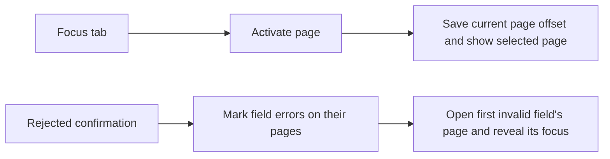

# V01 minimal edit form (S1)

> **Review-fix status (2026-11-05):** Applications and the V01 acceptance driver use typed handles and data connections; native input and geometry checks use the internal host interface. See [rework verification](evidence/rework-verification.md) for the results and limits. The original [verification](evidence/verification.md) records the earlier S1 revision.

The [S1 implementation ticket #15](https://github.com/isoduo/Isoduo-issues/issues/15) delivers a minimal V01 edit form built with the official C01 label, C02 button, and C03 single-line text field. It runs with both Minimal Web and Material-inspired appearances. The two appearances share the same form logic, editing state, and acceptance cases. Only the presentation and arrangement of parts differ. Data stays in memory.

The public API is still unstable. Its types and callback signatures may change during S2-S5.

## S3: tabs and page scopes (#21)

The desktop example starts with three fixed tabs. Left and Right move the tab candidate; Enter or Space activates it, and a pointer click activates the clicked enabled tab. The selected tab and keyboard candidate are independently indicated. Disabled pages cannot be activated. An exclamation mark on a tab indicates that a member has a validation error. The framework switches to and reveals the first invalid field in a rejected cross-page confirmation group; errors on other pages remain marked on their tabs.

V01 retains its existing form. V02 uses the same list page and application model as the standalone example: choose a sample, filter by name, reverse the order, disable T008, or delete the selected item. V03 has the progress display, dialog, and tooltip described below. Each page has its own reset; switching retains drafts, history, list selection and the valid page and list scroll offsets. Resetting V02 or V03 leaves V01 untouched.

Applications create tabs with `Ui::addTabs` and typed `ComponentHandle` members, and use `TabsHandle` for activation and queries. Page membership determines operation admission and rendering. `TabsHandle::addMember` attaches an existing component of any supported type to a page; foreign and already attached handles are rejected. `layout::pinned` keeps the tabs visible above the page's scroll region. Page identity uses `OptionValue`; the application saves per-page scroll state through the page-change callback. A hidden component returns `Status::hidden` for normal operations. A current page cannot be disabled; a page change attempted recursively from its callback is rejected as busy.

## S4: progress (#22)

V03 starts at 50%. Its 0, 50, 100, -10 and 110 buttons change the application-owned source immediately. The progress bar and percentage clamp the displayed value to 0–100, while the source label keeps the original number visible. Reaching 100% does not imply that a background task succeeded. Reset page restores 50% and its scroll position; other pages are retained.

Applications create a non-focusable `ProgressHandle` with `Ui::addProgress` and connect a read-only `Source<int>`. The source must outlive the connection and deliver change notifications on the UI thread. The handle's semantic value and numeric value report the clamped percentage; the application can read its own source separately. There is no progress write connection, and destroying the UI disconnects the subscription.

## S4: tooltip (#24)

The V03 **50%** button has explanatory text. Hover over it or give it keyboard focus and wait 500 ms; the tooltip does not take focus or intercept pointer input. Escape hides it for the current visit, and leaving and returning starts a fresh delay. Opening the dialog, hiding or disabling the source, or deactivating the window closes it. Reactivating the window recalculates eligibility and starts a new delay. The tooltip follows the source's selected appearance, wraps and stays inside the window; the source exposes its text as a semantic description.

Applications attach a tooltip using `Ui::addTooltip(id, source_handle, text, delayMs)`. The source is a non-owning typed handle; the returned `TooltipHandle::visible()` reports whether the tooltip is shown. The delay defaults to 500 ms and can be shortened in tests. Removing the source invalidates the tooltip handle and cancels its pending display. In V03 the existing button still updates the application-owned progress model only when activated.

## S4: modal dialog (#23)

V03's **Reset progress...** opens a window-modal confirmation. Initial focus is Cancel; Tab and Shift+Tab stay inside the dialog, Escape cancels, and the mask blocks background input without closing it. Confirm sets the application-owned progress to 0% and increases the confirmation count once; cancel preserves progress. The displayed result and count are reset with V03. The test seam removes the temporary opener while the dialog is open; closing then returns focus to the permanent dialog opener. The host verification seam also opens the dialog during V01 composition.

Applications assemble dialog content from typed handles, register its initial and fallback focus targets with `Ui::addDialog`, and open or settle it through `DialogHandle`. `layout::modal` places the content above the window and its mask; it uses the same selected appearance as the opener in this example. `ButtonHandle::remove` accepts owner configuration and commits removal after the outermost UI operation. Pending and removed targets reject operations; their non-owning handles remain invalid even if an ID is reused. This slice provides one dialog at a time; it does not implement nested dialogs or runtime appearance overrides.

## S2c: region and popup layer

Region starts at North, with Central and South available. Enter or a click opens the non-editable dropdown; arrows move a candidate without changing the draft. Enter or clicking an option selects the draft, while Escape, Tab and an outside click cancel the candidate. Tab continues to the next component and an outside click still acts on its target. Apply submits the region with the other four drafts. The region fixture clears or restores the options; clearing removes the selection, and restoring requires an explicit new selection. A missing region is reported on the region field, after name in validation focus order. Reset restores North.

Applications create a `DropdownHandle` with stable `OptionValue` identities, connect a `Source<std::optional<OptionValue>>`, and choose immediate, confirmed, or group-confirmed writing. `setItems` rejects duplicate or empty identities, clears a draft or candidate whose identity is no longer enabled, and does not revive it when options return. A popup belongs to its source and uses its appearance. The window-level overlay is drawn and hit above normal content and scrollbars; it anchors below the source when possible, otherwise above, and clamps to the window. `layout::stack` places children at one origin with later children above earlier ones.

## S2b: volume slider

Volume starts at 40 with range 0-100 and step 5. Drag the track, use arrow keys to move to the next value, or use Home/End for the endpoints. The current value is shown beside the slider. The value is a draft until Apply submits it with the name, notices and mode in one confirmation group; Reset restores 40. When an external source update conflicts with a draft, the slider displays the conflict and its **Use latest volume** action restores the source value.

`SliderHandle` connects an application-owned `Source<int>` to an explicitly immediate, confirmed, or group-confirmed numeric write. The integer slider accepts a minimum below its maximum and a positive step. Programmatic values outside the range return `invalidValue`; in-range values are snapped to the nearest minimum-plus-step value or the maximum, whichever is closest; ties go upward. Thus a non-divisible final interval remains reachable and arrows move between adjacent valid values. Source values must already be valid: an invalid initial source rejects connection, and an invalid notification keeps the last valid source value and shows an error. Source lifetime and UI-thread notification requirements match the other connections.

## S2a: checkbox and radio group

The form now includes **Notices** (initially checked) and **Mode** (initially Normal, with Focus and Offline options). Space or a click toggles Notices. Click an option or use the arrow keys to select a mode; navigation skips disabled choices and stops at the ends. The Offline fixture toggles whether Offline can be selected. Reset restores both initial values and re-enables Offline. The current draft and last applied result include all three fields. Apply passes the text, boolean, and option drafts together to one application callback.

Application code creates these fields through `CheckboxHandle` and `RadioGroupHandle`, connects typed sources, and explicitly chooses immediate, confirmed, or group-confirmed writing. Option identities use `OptionValue`; a source of another type requires an explicit adapter. The fields expose draft and semantic state through their handles. The confirmation callback receives typed changes and can return errors associated with individual handles. Source notifications must be delivered on the UI thread and the source must outlive the connection, as for text fields.

The S1-specific descriptions below are historical where they list only the original text field and focus order. The S2a verification and remaining limits are recorded in [rework verification](evidence/rework-verification.md).

## Building and running

You need Visual Studio C++ Build Tools and the Windows SDK, clang-cl, CMake, and Ninja. The build uses the HarfBuzz and FreeType sources bundled in the repository, with no downloads or package manager. Run these commands in PowerShell from the repository root.

~~~powershell
.\build.ps1 -Configuration Release          # Build and run all CTests, including native verification with a real window
.\build\Release\isoduo_edit_form_web.exe       # Minimal Web
.\build\Release\isoduo_edit_form_material.exe  # Material-inspired
.\build.ps1 -Configuration Release -CoreOnly  # Build only Core, with no window creation or linking against OpenGL or font libraries
~~~

Both executables use the same `main.cpp` and link different appearance libraries when assembled. They require an OpenGL 3.3 core driver and the Windows fonts Segoe UI and Microsoft JhengHei.

## Form and interaction

- **Name field.** The initial value is `測試使用者` (test user). Editing the name changes only the **Current draft** value. The **Last applied** result and **Apply count** stay the same.
- **Apply.** A valid name updates the result and increments the count exactly once. If the name is empty or consists only of whitespace, including ideographic spaces, leaving the field or pressing Apply shows **Enter a display name**. An invalid Apply attempt focuses the name field and keeps the previous result. Correcting the name clears the error. Enter and IME commits in the name field do not trigger Apply.
- **Test controls.** These remain available when the data area is disabled. The controls are **Normal**, **Name Read-Only**, **Disable Data Area**, **Name Error**, **Long Description**, and **Reset**. Reset restores the initial values, clears the name field's history and display offset, scrolls the page to the top, and leaves focus on the Reset button.
- **Keyboard.** Tab and Shift+Tab cycle through the test controls, the name field, and Apply, skipping disabled components. A button activates on Enter press or Space release, once per press even if held. The name field supports Left/Right, Home/End, Shift selection, Ctrl+A, Backspace/Delete, Ctrl+C/X/V, Ctrl+Z, and Ctrl+Y/Ctrl+Shift+Z. These operations affect only the name field.
- **Pointer.** A button activates when you press and release inside it. Pressing inside and releasing outside cancels activation. In the name field, click to place the caret, drag to select, or Shift+click to extend the selection.

## Policies and limits for this slice

| Item | Decision |
| --- | --- |
| Line breaks on paste | CRLF counts as one line break. A lone CR or LF also counts as one, and each break becomes a space. The presence of other control characters, such as Tab, causes the entire paste to be rejected and leaves the original text and history intact. |
| History granularity | Each ordinary insertion or deletion records one entry. A paste, including replacement of a selection, a cut, or an IME commit each records one entry. A new edit clears the field's redo history. |
| Text length limit | The **public** per-field setting `ComponentConfig::maxLength` defaults to `isoduo::defaultMaxTextLength = 4096` UTF-16 units. The value comes from the MVP. It is now in a public header and can be changed by the application. An edit that goes over the limit is rejected in full, preserving the previous text and history. Single-line fields need bounded input, and S1 does not call for a separate study of the limit. |
| E01 focus loss in a single field | **Commit preedit on focus loss.** Real Microsoft Bopomofo events established this policy. When you click another component or the same field, the host first asks the IME to complete preedit (`CPS_COMPLETE`), and the IME returns the result synchronously. When the window leaves the foreground, Bopomofo commits on its own. During preedit, the IME handles Tab, keeping focus and preedit in place. Esc cancels preedit. The field handle's `focus()` follows the same policy during preedit. The prototype's cancel-on-blur policy was dropped. |
| E01 close | On WM_CLOSE the host asks the IME to complete preedit using the same policy as focus loss. If the IME does not deliver a result synchronously, the remaining preedit is cancelled. |
| Text support limits (T01) | Text is left-to-right and single-line by default. Use `ComponentConfig::multiline` at creation to opt into multiple lines (see "Multi-line text fields" in the root README). This form uses single-line fields. Caret movement and deletion work by Unicode code point and keep UTF-16 surrogate pairs intact. Drawing and hit testing use HarfBuzz cluster boundaries as stops. Segoe UI is the primary font, with Microsoft JhengHei as a fallback selected per code point. If neither font contains a glyph, a missing-glyph marker is drawn. Full grapheme cluster support, RTL, and color emoji are out of scope. |
| Layout (B01-B03) | The demo provides columns, rows, grids that determine the column count from the minimum column width, and nested scroll regions. The list has a fixed-height viewport. Keyboard targets are revealed through each enclosing scroll region. When the inner region reaches its boundary, wheel input can pass to the outer region. At a narrow window width (640 DIP), the results move below the form. |

## Verification

The V01 behavior cases drive the assembled form through public handles; native keyboard, pointer, focus traversal and geometry checks use the host/test interface. The independent consumer also checks that string-ID layout and operations are unavailable.

| Entry point | Coverage |
| --- | --- |
| CTest `components`, `layout`, `edit_form` | Core public operations, layout, and form acceptance. These tests create no windows and require no fonts or GPU. The form cases run once for each combination of two appearances and two distinct sets of logical IDs. |
| CTest `consumer_example` | An independent CMake project ([examples/consumer](../consumer)) builds and runs another form using only the public targets and `include/`. |
| CTest `host_native` | `isoduo_host_verify --evidence DIR` uses a real Win32 window, with keyboard and mouse messages dispatched through the host's own `TranslateMessage` and `DispatchMessage`. It checks both appearances with offscreen layout and screenshots at 960 x 720 and 640 x 480 DIP, each at 100% and 150%. It does not take the foreground. |

See [evidence/rework-verification.md](evidence/rework-verification.md) for the acceptance record, toolchain, and representative screenshots.

## Justified text comparison (#84)

The **Presentation Settings** page (V04) ends with an initially justified label containing a paragraph in mixed Chinese, English, and digits, along with two dropdowns. **Alignment** offers **Left**, **Center**, **Right**, **Justify**, and **Distribute**. **Justification Method** offers **Automatic**, **Spaces Only**, and **Per Character**. Choosing from them sets the label's `textAlign` and `justifyMethod` live, so the project author can compare every alignment and method at any window width. Below it, a short label `姓　名` (surname and given name) is distributed next to the same label left-aligned. The paragraph is left-aligned while the user setting `PresentationSettings::justifyAsLeft` is on (the settings demo has the checkbox).
